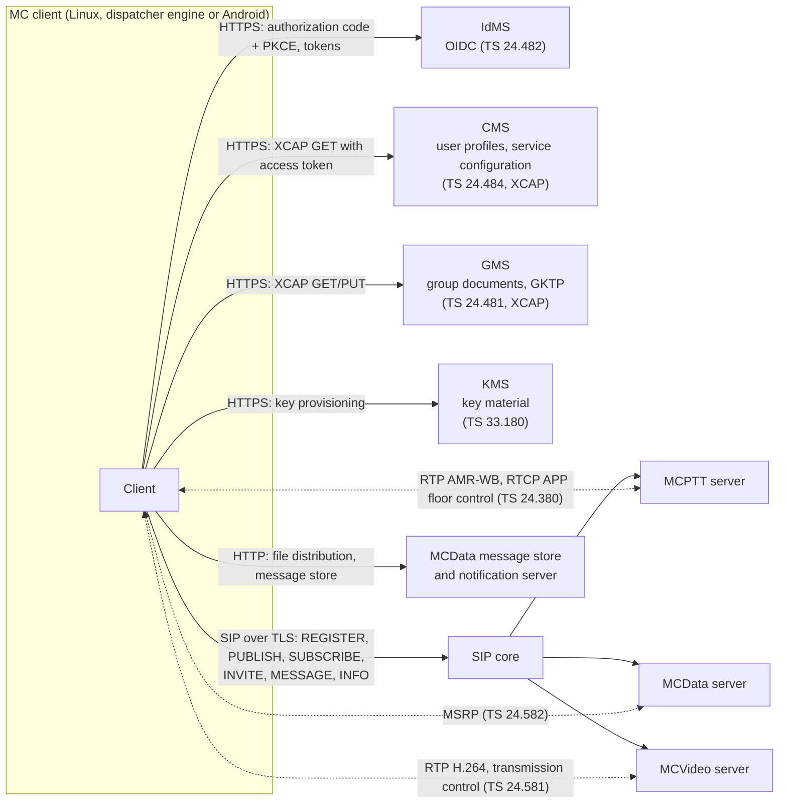
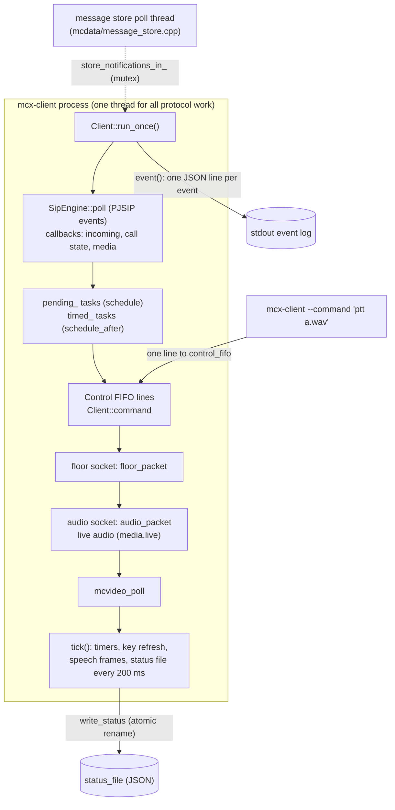
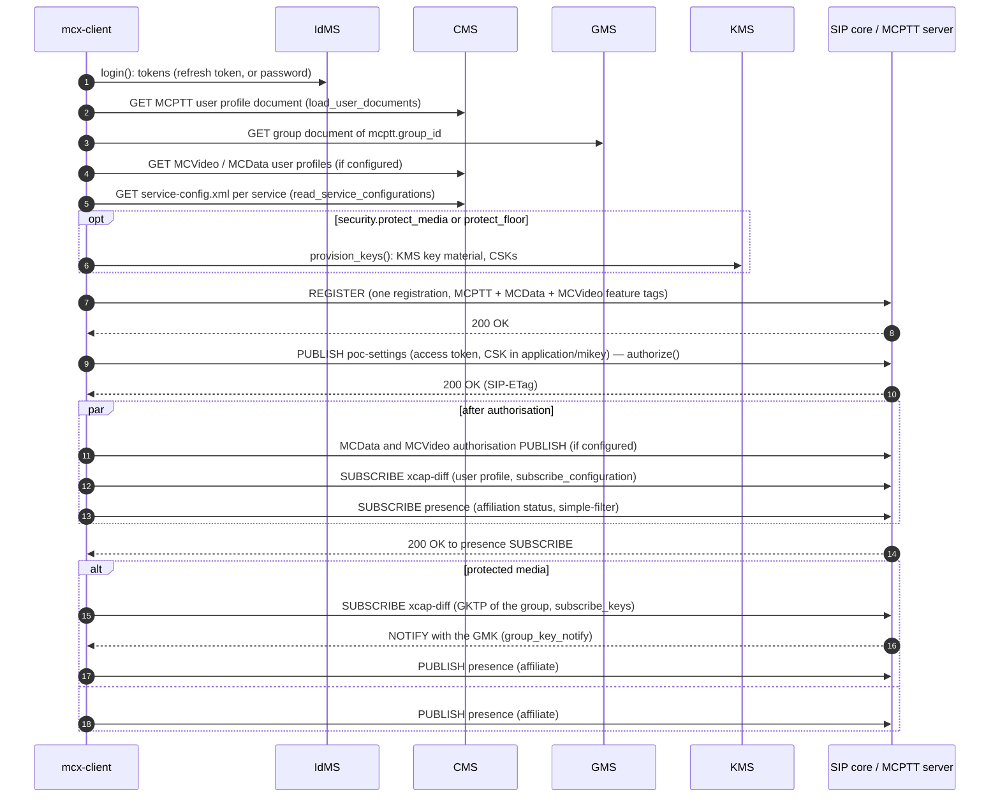
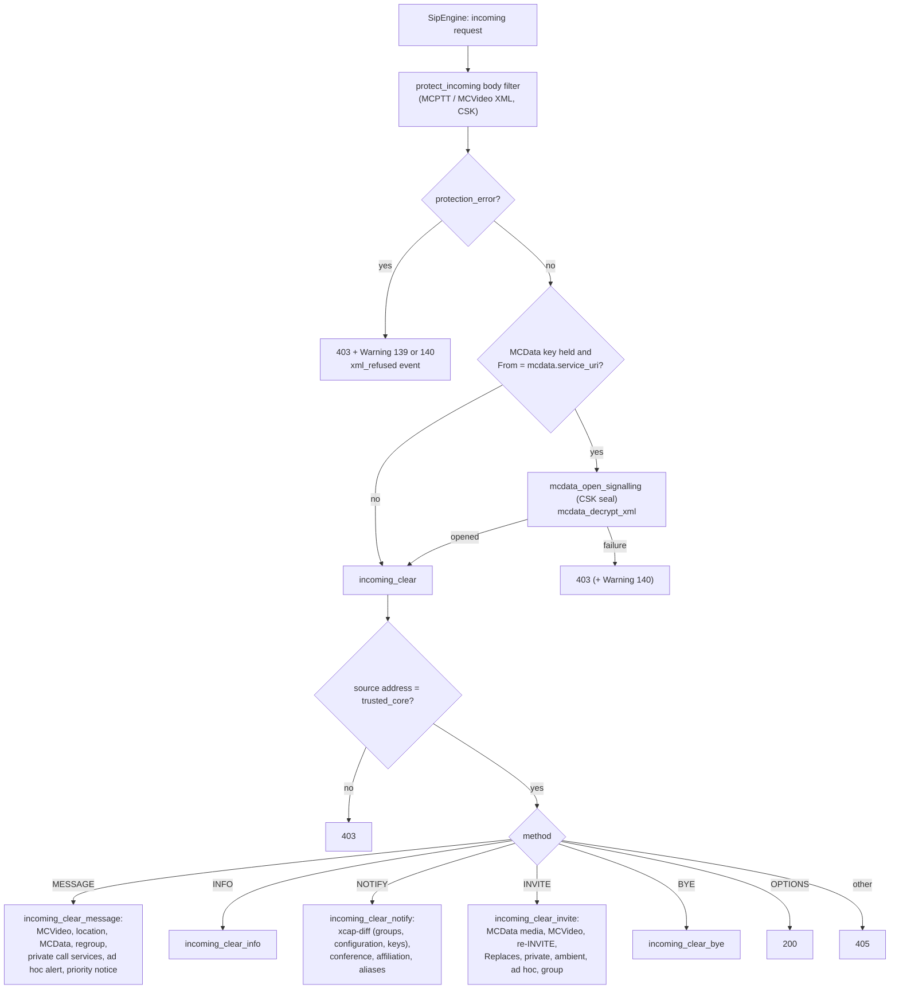
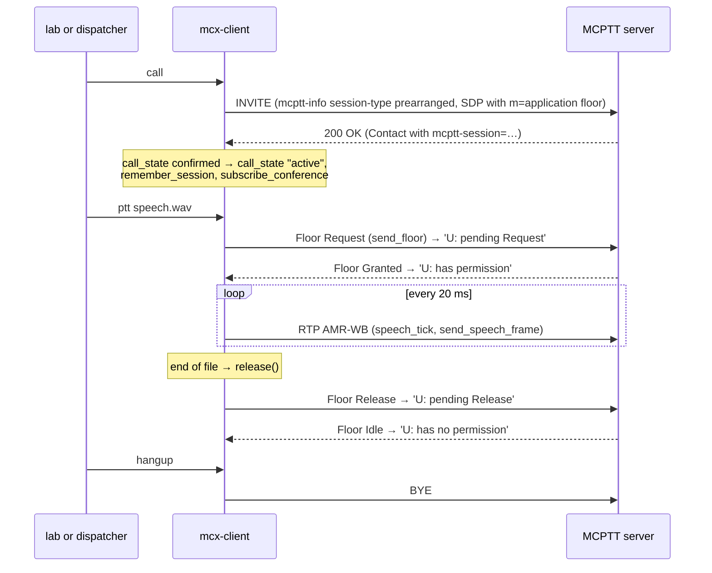
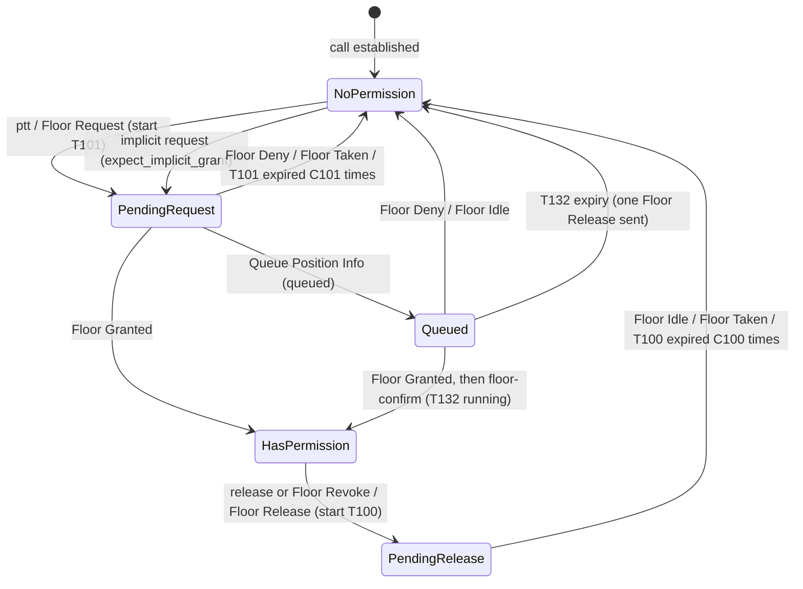
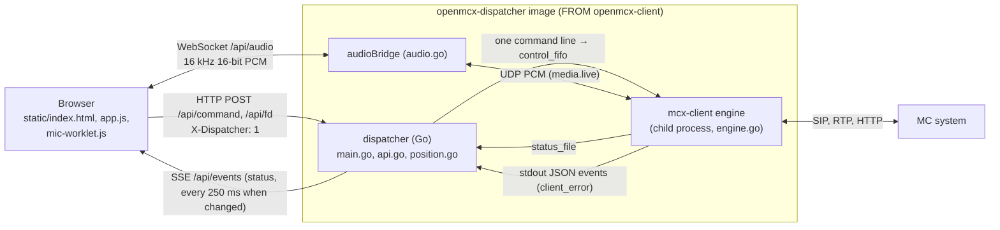
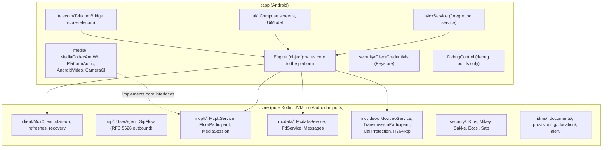

# The OpenMCX clients: developer guide

This guide is for a developer joining the OpenMCX clients. It explains how the three clients in this repository are
built, how a request flows through the Linux client, which 3GPP state machines the code implements and where, and how
to add or fix a procedure. It describes the code as it is; what each client supports is listed in the
[Linux client feature list](../linux/docs/FEATURES.md), the [dispatcher README](../dispatcher/README.md) and the
[Android README](../android/README.md).

Specification versions are those the source file headers cite: TS 24.379 V19.7.0, TS 24.380 V19.2.0, TS 24.282
V19.7.0, TS 24.582 V19.0.0, TS 24.281 V19.6.0, TS 24.581 V19.2.0, TS 26.281 V19.0.0, TS 33.180 V19.4.0, TS 24.481
V19.3.0, TS 24.482 V19.1.0, TS 24.484 V19.6.0, TS 24.545 V19.4.0 and TS 23.379 V19.11.0, all Release 19.

## Contents

1. [Overview](#1-overview)
2. [The Linux client](#2-the-linux-client)
3. [State machines](#3-state-machines)
4. [Security](#4-security)
5. [The dispatcher](#5-the-dispatcher)
6. [The Android app](#6-the-android-app)
7. [Testing](#7-testing)
8. [Development workflow](#8-development-workflow)
9. [Glossary](#9-glossary)

## 1. Overview

### 1.1 The three clients

| Client | Directory | Language | What it is |
|---|---|---|---|
| `mcx-client` | [`linux/`](../linux) | C++20 | A headless on-network MC UE in a container, driven by commands; the client of the openmcx-server lab scenarios |
| Dispatcher | [`dispatcher/`](../dispatcher) | Go, JavaScript | A position in the browser: a Go web service that runs `mcx-client` as its engine |
| Android app | [`android/`](../android) | Kotlin | A native Android MC UE with its own protocol engine |

All three are on-network clients of one MC system. Off-network (ProSe) operation, interconnection between MC systems
and migration are not implemented in any of them.

### 1.2 What is shared

- **The dispatcher reuses the Linux client.** Its image is built `FROM` the `openmcx-client` image and runs
  `/usr/local/bin/mcx-client` as a child process ([`dispatcher/Dockerfile`](../dispatcher/Dockerfile)). The Go service
  holds no protocol code; it sends engine commands and reads the engine's status file (section 5).
- **The Linux client shares protocol libraries with the servers.** `mcx-client` is built against an openmcx-server
  checkout ([github.com/openMCX/openmcx-server](https://github.com/openMCX/openmcx-server)), found through the CMake
  cache variable `OPENMCX_SERVER_DIR` (default `../../openmcx-server` from `linux/`). [`linux/CMakeLists.txt`](../linux/CMakeLists.txt)
  adds that checkout as a subdirectory and links its `mcx_sip` library, which brings `mcx_core` and `mcx_keying`.
  From the server repository the client takes:
  - the SIP engine (`SipEngine`, built on PJSIP) with registration, PUBLISH, SUBSCRIBE, INVITE sessions and the body
    filters used for XML protection;
  - the MC protocol bodies and codecs: MCPTT/MCVideo/MCData information, SDP, floor control and transmission control
    messages, MSRP, conference and affiliation documents, location, IP connectivity, AMR-WB and H.264 media;
  - the floor participant timers and state (`FloorParticipantTimers`, header `mcx/floor.hpp`);
  - key management and protection: `KeyClient`, `ProtectedCall`, MIKEY-SAKKE, SRTP/SRTCP, XML security;
  - the process runtime: configuration loading (`load_config`), the control FIFO (`Control`), the status file
    (`write_status`), the JSON event log (`event`) and the command-line parser (`arguments`).

  Build the client from the same openmcx-server commit as the server image under test.
  [`linux/tools/build-image`](../linux/tools/build-image) copies the server's `CMakeLists.txt`, `include/`, `src/` and
  `tools/healthcheck.py` into a staging directory beside the client sources, because the Docker build takes a single
  context.
- **The Android app shares no code with the Linux client.** Its engine in `android/core` is a separate Kotlin
  implementation of the same specifications (section 6).

### 1.3 How a client talks to the MC system



The configuration names the endpoints (`endpoints.cms`, `endpoints.gms`, `endpoints.msgstore`,
`endpoints.notification`), the SIP core (`sip.core_uri`, which must use `transport=tls`), the trusted core address
(`trusted_core`) and the PSIs of the MC servers (`mcptt.service_uri`, `mcdata.service_uri`, `mcvideo.service_uri`).
Group and configuration document changes arrive as SIP NOTIFY with the `xcap-diff` event package through the MCPTT
server's PSI.

## 2. The Linux client

### 2.1 Source tree

| Path | Contents |
|---|---|
| [`linux/CMakeLists.txt`](../linux/CMakeLists.txt) | One executable `mcx-client` (all three services) and the unit test `test_client_rules`; links `mcx_sip` from `OPENMCX_SERVER_DIR` |
| [`linux/src/client/core/client.hpp`](../linux/src/client/core/client.hpp) | The one class `mcx::Client`, its state and every member function declaration, grouped by the file that defines them |
| `linux/src/client/core/main.cpp` | Process entry: arguments, optional MCX Admin activation, `--command`/`--status`, then `Client::run()` |
| `core/client.cpp` | Construction, start-up, the run loop (`run`, `run_once`), the periodic `tick`, the status file (`save_status`) |
| `core/commands.cpp` | The command interface: `Client::command`, `Client::run_command` and the MCPTT commands |
| `core/sip_dispatch.cpp` | `Client::incoming`: protection checks of every incoming SIP request, then `incoming_clear` |
| `core/tokens.cpp` | IdMS sign-in (`login`, `obtain_tokens`), refresh tokens, token renewal and re-authorisation |
| `core/activation.cpp`, `activation.hpp` | MCX Admin activation from a one-time URL (OpenMCX provisioning, not 3GPP) |
| `core/xml_protection.cpp` | MCPTT and MCVideo XML confidentiality and integrity protection under the CSK |
| `core/protected_call.cpp` | PCK offer and acceptance, the GMK subscription (`subscribe_keys`), protected floor transmission |
| `core/group_management.cpp` | Group management client (TS 24.481) and configuration management client (TS 24.484) |
| `core/location.cpp`, `core/seal_location.cpp` | MCPTT and MCData location reporting; the SEAL location management client (TS 24.545) |
| `core/client_rules.hpp` | Stateless rules kept apart from `Client` so that they can be unit tested |
| `linux/src/client/mcptt/` | Service authorisation and affiliation (`service.cpp`), incoming requests and terminating calls (`incoming_calls.cpp`), call state, floor messages and media (`call_media.cpp`), private calls, private call services, priority and emergency, ad hoc calls, functional aliases, regroups, ambient listening and call suspension, live audio for the dispatcher |
| `linux/src/client/mcdata/` | Authorisation and SDS over the signalling plane (`service.cpp`), the incoming request dispatcher and commands (`dispatch.cpp`), protection, MSRP media plane, file distribution, IP connectivity, emergency alert, priority states, communication release, message store |
| `linux/src/client/mcvideo/` | Authorisation and affiliation (`service.cpp`), calls (`call.cpp`), sessions, transmission control and video (`session.cpp`), functional aliases, location and ad hoc alert, remote group selection |
| [`linux/tests/`](../linux/tests) | `test_client_rules.cpp` (unit tests of `client_rules.hpp`) and `test_binary.py` (the executable contract) |
| [`linux/docker/Dockerfile`](../linux/docker/Dockerfile), [`linux/tools/build-image`](../linux/tools/build-image) | The image build |
| `linux/tools/` | `format`, `lint`, `check-names.py` |

`Client` is one class whose member functions are defined one topic per file. A UE runs MCPTT, MCData and MCVideo
together, so the services share the registration, tokens, keys, location and the run loop. The MCData and MCVideo
parts are active only when the configuration has an `mcdata` or `mcvideo` object (`mcdata_enabled()`,
`mcvideo_enabled()`).

### 2.2 Process model



- **One loop.** `Client::run()` performs start-up and then calls `run_once()` until SIGINT or SIGTERM sets `stopping`
  (or the `quit` command). Each pass polls the SIP engine for 5 ms, runs the scheduled tasks, reads the control
  commands, drains up to 32 datagrams each from the floor and audio sockets, polls MCVideo media and runs `tick()`.
  The only other thread is the message store notification channel poller in `mcdata/message_store.cpp`.
- **Deferred work.** SIP callbacks must not start new transactions inline, so handlers call `schedule()` (next pass)
  or `schedule_after()` (after a delay). An exception in a task or command is reported with `failure()`, which sets
  `last_error` in the status file and emits a `client_error` event.
- **Commands.** `mcx-client --config <file> --command '<text>'` writes one line to the FIFO named by `control_fifo`
  in the running client's configuration and exits (`dispatch_control` in the shared runtime). The running client
  reads the line in `run_once()` and passes it to `Client::command()`. `command()` signals the location triggers of a
  call request and wraps call-placing commands in `place_call()`, so that a listened-to user leaves its ambient
  listening call; `run_command()` then matches the command text. Commands with a prefix go to the service that owns
  them: `sds…`, `mcdata-…`, `fd-…`, `ipcon…` to `mcdata_command`; `mcvideo-…` to `mcvideo_command`; `location …` to
  `location_command`; `seal …` to `seal_command`; `group-…` and `temporary-…` to `group_management_command`;
  `callback…`, `remote-call`, `remote-group-call`, `transfer` and `forward` to `private_service_command`. For example:
  - `ptt <wav>` (`ptt_command`) loads a WAV file and sends Floor Request; with `ptt live` the speech comes from the
    dispatcher's UDP port instead;
  - `callback <id> [low|normal|high]` sends a private call call-back request (TS 24.379 clause 11.1.5.2.1);
  - `refresh-reinvite` is a test aid: a session refresh by re-INVITE (RFC 4028 section 7.4) without MC service
    information; the final status is kept in `last_refresh`.

  An unknown command throws `unknown client command`. The full list is in the comment above `Client::run_command` and
  in each `*_command` function.
- **Status.** `save_status()` writes the whole client state as JSON to `status_file` every 200 ms; `--status` prints
  it. Labs and the dispatcher read state only from this file. Each service adds its part (`mcdata_status()`,
  `mcvideo_status()`).
- **Events.** `event(kind, detail)` writes one JSON line to stdout with `event` and `monotonic_ms` fields, for
  example `{"event":"floor_granted",…}`. The dispatcher reads `client_error` events from this stream (section 5).

### 2.3 Start-up

`Client::run()` runs the start-up steps in order; everything after the REGISTER is chained through SIP response
callbacks.



Where each step lives:

| Step | Function | Specification |
|---|---|---|
| User authentication | `Client::login`, `Client::obtain_tokens` (`core/tokens.cpp`) | TS 24.482 clause 6.2.1; refresh tokens TS 33.180 annex B.4, B.5 |
| MCPTT user profile, group document | `Client::load_user_documents` (`core/client.cpp`) | TS 24.484 clause 8.3.1A, TS 24.481 clause 6.3.3.2.2 |
| MCVideo, MCData user profiles | `read_mcvideo_profile`, `read_mcdata_profile` | TS 24.484 clauses 9.3.1A, 10.3.1A |
| Resource-Priority values | `read_service_configurations` | TS 24.484 clauses 8.4.2.8, 9.4.2.8, 10.4.2.8 |
| Key provisioning, CSKs | `provision_keys` | TS 33.180 clauses 5.3.3, 5.4 |
| REGISTER | `SipEngine::register_account`, configured by `client_sip_config` (`core/client.hpp`) | TS 24.379, TS 24.282, TS 24.281 clause 7.2.1AA |
| Service authorisation | `Client::authorize` (`mcptt/service.cpp`), `mcdata_authorize`, `mcvideo_authorize` | TS 24.379 clause 7.2.2, TS 24.282 clause 7.2.2, TS 24.281 clause 7.2.2 |
| Service authorisation by REGISTER (`mcptt.authorise_by_register`) | `register_authorization`, body from `register_body`, then `service_authorized`, shared with the PUBLISH; MCData and MCVideo in `mcdata_authorize`, `mcvideo_authorize`; one REGISTER at a time through `queue_register` | TS 24.379, TS 24.282, TS 24.281 clause 7.2.1 |
| Configuration subscription | `subscribe_configuration`, `configuration_notified` (`core/group_management.cpp`) | TS 24.484 clause 6.3.13.2.2 |
| Affiliation status subscription | `subscribe_affiliation`, body from `affiliation_subscribe_body`; refreshed by `refresh_affiliation_subscription` | TS 24.379 clause 9.2.1.3, RFC 6665 section 4.1.2.1 |
| Group key | `subscribe_keys`, `group_key_notify` | TS 24.481 clause 6.3.13.2.1, TS 33.180 clause 5.7 |
| Affiliation | `Client::affiliate`; the selected group and the monitored ones (`monitor_command`), each group's status in `affiliation_notify` | TS 24.379 clause 9.2.1.2, clause 9.2.1.3 |

Token renewal (`schedule_token_renewal`, `renew_token`) signs in again ten minutes before the token expires (halfway
for a token that lives less than 20 minutes) and sends the MCPTT, MCData and MCVideo authorisation PUBLISH again with
SIP-If-Match.

The MCPTT and MCVideo affiliation status subscriptions ask for Expires 4294967295 (TS 24.379 clause 9.2.1.3 step 4,
TS 24.281 clause 8.2.1.3 step 4). The server may grant less in its 200 (OK); `subscription_granted` records the granted
duration and `tick` re-subscribes in the dialog (`refresh_affiliation_subscription`) a minute before it ends, or
half-way through a shorter one. A refused refresh is replaced by a new subscription; the affiliations and any call are
kept. The `refresh-affiliation` command triggers a refresh at once (a test aid). A 4xx–6xx answer to the authorisation PUBLISH ends the authorisation, the affiliations and any call
(`authorization_lost`); after a 412 the client discards the entity-tags and publishes anew (RFC 3903 section 5). A
refused initial authorisation that can be transient (403, 408, 480, 486, 500, 503) is published again after 5, 10 and
20 s, then every 60 s, or after the Retry-After of a 500 or 503 (`retry_authorization`, the delays in
`client_rules::authorization_retry_delay_ms`); each retry is reported by a `service_authorization_retry` event, and a
retry is dropped when another authorisation PUBLISH went out meanwhile. A 486 (warning 164, 166 or 228) means the user
is authorised on another client: the retry succeeds once that one logs off or its authorisation ends.

The `log-off` command (`core/log_off.cpp`) logs off every MC service the client is authorised for (TS 24.379, TS 24.281
and TS 24.282 clause 7.2.1A step 4): it ends the call and the subscriptions held with the authorisations (SUBSCRIBE with
Expires 0), sends each server a poc-settings PUBLISH with Expires 0, the entity tag in SIP-If-Match and no body (RFC
3903 section 4.5), and when all have answered deletes the dynamic keys (CSKs, PCKs and the keys derived from them and
the GMKs; TS 33.180) and de-registers (`SipEngine::unregister_account`). The tokens and KMS key material stay; nothing
authorises a service again until `log-on`, which registers again and authorises with new CSKs. The status file shows
`logged_off`, the servers' answers in `log_off` and the de-REGISTER's in `deregistered`.

### 2.4 Incoming request pipeline

The SIP engine hands each incoming request to `Client::incoming` (`core/sip_dispatch.cpp`). The XML body filters
installed in `run()` (`protect_incoming`) have already verified and decrypted MCPTT and MCVideo XML under the CSK; a
failure arrives as `SipMessage::protection_error`.



Every handler below `incoming_clear` runs inside its `try` block: an exception answers 400 and is reported with
`failure()`. Handlers check that a request comes from the expected server (`From` and P-Asserted-Identity against the
service URI) and answer 403 otherwise. They return the SIP response and schedule follow-up requests with
`schedule()`.

Dialog state changes come back through the `call_state` callback (`mcptt/call_media.cpp`), which routes IP
connectivity and MCData media plane dialogs to their own state before the MCPTT call; MCVideo dialogs are taken first
by `mcvideo_call_state`. Negotiated media arrives through the media callback set up in the `Client` constructor
(`core/client.cpp`), which checks the answer (`check_remote`, TS 24.379 clause 6.2.1) and the negotiated floor
priority.

### 2.5 Walkthroughs

#### Group call and floor control



- `group_call_command` (`core/commands.cpp`) checks authorisation, affiliation and idle state, builds the MCPTT
  information (session type, emergency, imminent peril, broadcast, functional alias, `<associated-group-id>` for a
  regroup) and the Resource-Priority headers (`priority_headers`), then `invite_group_call` sets the floor priority,
  floor SSRC and queueing and sends the INVITE (TS 24.379 clauses 10.1.1.2.1.1 and 10.1.2.2.1.1).
- `ptt_command` sends Floor Request through `send_floor` (TS 24.380 clause 6.2.4.3.5). `floor_packet` validates
  each floor message (source address and port, SSRC, SRTCP when `security.protect_floor`), acknowledges it when asked,
  filters duplicates (`FloorSequenceTracker`), feeds `FloorParticipantTimers::receive` and acts on Floor Granted,
  Queue Position Info, Deny, Revoke, Idle and Taken.
- `floor_participant_tick` (`core/client.cpp`) retransmits pending requests and reports `floor_lost` when the floor
  ended while the user was talking.
- An incoming group call arrives in `incoming_group` (`mcptt/incoming_calls.cpp`, TS 24.379 clause 10.1.1.2.1.2).

#### Private call

- `private_call` (`mcptt/private_call.cpp`) builds the request in `private_call_parts` (TS 24.379 clause
  11.1.1.2.1.1): automatic, manual or forced commencement, with or without floor control, emergency, functional alias
  target. With protected media `offer_private_key` puts a PCK in `a=key-mgmt` (step 11).
- `private_call_response` and `private_call_answered` handle the answer, including a 300 for a functional alias
  (`private_call_alias_redirect`) and a 488 carrying a KMS Redirect Response (`private_call_kms_redirect`).
- Terminating side: `incoming_private` and `adopt_incoming_private` (TS 24.379 clause 11.1.1.2.1.2); manual
  commencement leaves `call_state` at `ringing` until `answer` or `reject` (`answer_command`).
- First-to-answer (`first_to_answer_call`), ambient listening (`ambient_call`, `incoming_ambient`), transfer, forwarding,
  remotely initiated calls and call-back are in `mcptt/private_services.cpp`.

#### Emergency and imminent peril

- `call emergency`, `call imminent`, `chat emergency` start a group call with that priority (`group_call_command`).
- `emergency on|off`, `imminent on|off` → `change_priority` (`mcptt/priority.cpp`): a re-INVITE in the active group
  call's dialog, or, outside a call, a SIP MESSAGE that cancels the emergency state of an affiliated user; the
  Resource-Priority comes from the service configuration document (TS 24.379 clauses 10.1.1.2.1.3 to 10.1.1.2.1.5).
  The answer is handled in `priority_response`.
- `alert on|off [<user>]` → `change_alert`: the emergency alert and its cancellation by an authorised user (TS 24.379
  clauses 12.1.1.1, 12.1.1.2).
- In a private call, `emergency on alert` → `change_private_priority`, which moves MEPC, MEPP and MPEA (section 3).
- Received notices and in-call priority changes arrive in `priority_notice`, `incoming_clear_info` and
  `private_priority_info`.
- `adhoc-alert …` → `adhoc_alert` (`mcptt/adhoc.cpp`): the ad hoc group emergency alert (TS 24.379 clause 12.1A.1),
  state AH-MEA.

#### MCData

- **SDS over the signalling plane.** `sds`, `sds-group`, `sds-adhoc`, `sds-fa` → `mcdata_sds_command` →
  `mcdata_send_sds` (`mcdata/service.cpp`, TS 24.282 clause 9.2.2.2.1): checks authorisation and the MCData user
  profile right `allow-transmit-data`, builds the MCData information, signalling and DATA PAYLOAD parts, protects the
  payload (`mcdata_protect_sds`) and sends a SIP MESSAGE to the MCData server. Received SDS go through
  `mcdata_incoming` (`mcdata/dispatch.cpp`), which checks P-Asserted-Identity and P-Asserted-Service, then dispatches
  on the signalling message type: file distribution, FD and SDS notifications, or `mcdata_sds_received`. Disposition
  notifications are answered by `mcdata_notify`; timer TDU1 is kept per message.
- **SDS and FD over the media plane.** `sds-media`, `sds-session`, `fd-media` open an INVITE with MSRP media
  (`mcdata/media.cpp`, TS 24.282 clause 9.2.3 with TS 24.582); the terminating side is `mcdata_media_invite`
  (`mcdata/media_session.cpp`).
- **File distribution over HTTP.** `fd-send` → `mcdata_send_file` (`mcdata/file_distribution.cpp`, TS 24.282 clause
  10.2.4.2.1): upload to the media storage function, then a SIP MESSAGE with the FD signalling; `fd-accept`,
  `fd-reject`, `fd-defer` answer an offer.
- **Location.** MCData has its own location reporter (`mcdata_location_*` in `core/location.cpp`, TS 24.282 clause
  17.3) sharing the UE's simulated position (`location position …`).
- Others: emergency alert (`mcdata/alert.cpp`), IP connectivity (`mcdata/ipconn.cpp`), communication release
  (`mcdata/release.cpp`), message store (`mcdata/message_store.cpp`).

#### MCVideo

- MCVideo shares the registration; it authorises and affiliates to the MCVideo server's PSI (`mcvideo_authorize`,
  `mcvideo_subscribe`, `mcvideo_affiliate` in `mcvideo/service.cpp`) with its own CSK and key client.
- One MCVideo call at a time, held in `McvideoCall` (`client.hpp`), beside the MCPTT call. `mcvideo-…` commands go to
  `mcvideo_command`: group calls (`mcvideo_group_call`), private calls, video push and pull, ambient viewing, ad hoc
  calls, remote transmission and reception control.
- Transmission control is handled in `mcvideo_control_packet` (`mcvideo/session.cpp`, TS 24.581 clause 6.2);
  transmission control that arrives before the SDP answer is kept in `early_control`. While granted, the client
  encodes a test pattern with OpenH264 (`video::Encoder`) and sends H.264 over RTP; received video is depacketised
  and decoded, and checksums of sent and received pictures go to the status file (`mcvideo_sent_frames`,
  `mcvideo_received_frames`).

### 2.6 Configuration settings for the dispatcher

Four settings exist for the dispatcher and are off unless configured: `media.live` (live 16 kHz PCM over local UDP
instead of WAV files, `mcptt/live_audio.cpp`), `sip.register_expires` (default 3600 s, 600 000 s with IMS AKA,
`register_expires()`),
`mcptt.group_from_profile` (`group_from_profile()`), `oauth.forget_password`, and `oauth.authorization` with
`--authorization-request` (sign-in on IdMS's page, `obtain_tokens()`).

## 3. State machines

### 3.1 Which machines, where, and how they are exposed

The client implements the on-network participant side of these machines. The "status key" column is the key in the
status file that shows the state; labs and the dispatcher read it there.

| Specification machine | Clause | Linux file and type | Status key and values |
|---|---|---|---|
| Floor participant (TS 24.380): 'U: has no permission', 'U: pending Request', 'U: has permission', 'U: pending Release', 'U: queued'; timers T100, T101, T103, T104, T132; counters C100, C101, C104 | TS 24.380 clauses 6.2.4, 11.1.1, 11.2.1 | `FloorParticipantTimers` and `FloorParticipantState` (shared library, `mcx/floor.hpp`), driven by `floor_packet`, `send_floor`, `release`, `floor_participant_tick` (`mcptt/call_media.cpp`, `core/client.cpp`) | `floor_state`: `NoPermission`, `PendingRequest`, `HasPermission`, `PendingRelease`, `Queued`; also `queued`, `pending_floor_confirmation`, `queue_position`, `floor_owner`, `last_floor_loss` |
| MCVideo transmission participant (TS 24.581) | TS 24.581 clause 6.2.4, reception control clause 6.2.5 | No state type: `McvideoCall::granted`, `requesting`, `receiving`, `queue_position`, the transmitter's SSRCs (`client.hpp`), set in `mcvideo_control_packet` (`mcvideo/session.cpp`; on-network the Media Transmission Notification announces another transmitter, clause 6.2.5.3.2) | `mcvideo_transmitting`, `mcvideo_transmitter`, `mcvideo_transmitter_ssrcs`, `mcvideo_receiving`, `mcvideo_queue_position`, `mcvideo_revocations`; the call: `mcvideo_call_state` (`idle`, `calling`, `ringing`, `joining`, `active`) |
| MEPC, emergency private call | TS 24.379 annex G.11 | `Client::mepc_` (int), `mepc_name` (`mcptt/priority.cpp`) | `private_emergency_state`: `MEPC 1: emergency-pc-capable`, `MEPC 2: emergency-pc-requested`, `MEPC 3: emergency-pc-granted` |
| MEPP, emergency private priority | TS 24.379 annex G.10 | `Client::mepp_`, `mepp_name` | `private_priority_state`: `MEPP 1: no-emergency` … `MEPP 4: confirm-pending` |
| MPEA, private emergency alert | TS 24.379 annex G.12 | `Client::mpea_`, `mpea_name` | `private_alert_state`: `MPEA 1: no-alert` … `MPEA 4: emergency-alert-cancel-pending` |
| AH-MEA, ad hoc group emergency alert | TS 24.379 clause 12.1A.1, annex G.20 | `Client::ah_mea_` (int), named in `save_status` (`core/client.cpp`) | `adhoc_alert_state`: `AH-MEA 1: no-adhoc-alert` … `AH-MEA 4: adhoc-emergency-alert-cancel-pending` |
| PCCB-I, private call call-back, requesting side | TS 24.379 clause 11.1.5, table G.13-1 | `Client::pccb_requesting_` (JSON: MCPTT ID → state string), `private_service_command`, `service_message` (`mcptt/private_services.cpp`) | `callback_requests_sent`: `PCCB-I2: confirm-pending`, `PCCB-I3: confirmed`, `PCCB-I4: cancel-pending`; no entry is PCCB-I1 |
| PCCB-R, private call call-back, target side | TS 24.379 clause 11.1.5, table G.13-2 | `Client::pccb_target_` | `callback_requests_received`: entries with `state` `PCCB-R2: private-call-pending`; removed when the call-back is made or cancelled |
| MDEA, MCData emergency alert | TS 24.282 table G.4.1-1 | `Client::mdea_`, `mdea_name` (`mcdata/alert.cpp`) | `mcdata_alert_state`: `MDEA 1: no-alert` … `MDEA 4: emergency-alert-cancel-pending` |
| MDEG, MCData emergency group | TS 24.282 table G.4.4-1 | `Client::mdeg_`, `mdeg_name` (`mcdata/priority.cpp`) | `mcdata_group_emergency_state`: `MDEG 1: no-emergency` … `MDEG 4: confirm-pending` |
| MDEGC, MCData emergency group communication | TS 24.282 table G.4.5-1 | `Client::mdegc_`, `mdegc_name` | `mcdata_group_emergency_communication_state`: `MDEGC 1: emergency-gc-capable` … `MDEGC 3: emergency-communication-granted` |
| MDIG, MCData imminent peril group | TS 24.282 table G.4.7-1 | `Client::mdig_`, `mdig_name` | `mcdata_group_imminent_state`: `MDIG 1: no-imminent-peril` … `MDIG 4: confirm-pending` |
| MDIGC, MCData imminent peril group communication | TS 24.282 table G.4.8-1 | `Client::mdigc_`, `mdigc_name` | `mcdata_group_imminent_communication_state`: `MDIGC 1: imminent-peril-gc-capable` … `MDIGC 3: imminent-peril-communication-granted` |
| MDEPC, MCData emergency private communication | TS 24.282 table G.4.11-1 | `Client::mdepc_`, `mdepc_name` | `mcdata_session_emergency_state`: `MDEPC 1: emergency-pc-capable` … `MDEPC 3: emergency-pc-granted` |
| MCVideo AH-MEA | TS 24.281 clause 12.1A.1, annex G.20 | `Client::mcvideo_ah_mea_` (`mcvideo/location.cpp`) | `mcvideo_adhoc_alert_state`: the state number only (1 to 4) |

What is not held as a spec machine:

- **MCPTT group emergency and imminent peril.** The client keeps `emergency_`, `imminent_`, `priority_pending_` and
  the set `alerts_` (`client.hpp`), shown as `priority` (`normal`, `emergency`, `imminent`), `priority_pending`,
  `alerts` and `alert_pending`. The group-call machines of TS 24.379 annex G (MEGC, MEG, MIGC, MIG and the emergency
  alert machine for groups) are not modelled with their state names.
- **MCPTT call state.** `call_state` (`idle`, `calling`, `progress`, `ringing`, `answering`, `active`) is the client's
  own view of the SIP dialog, not a 3GPP state machine.
- **Off-network machines** (TS 24.380 clause 7, the off-network annexes of TS 24.379, TS 24.281 and TS 24.282) are out
  of scope.

### 3.2 The floor participant

The state is held by `FloorParticipantTimers`, which the client gets from the server repository's shared library. The
transitions below are those of `FloorParticipantTimers::send`, `receive`, `tick` and `confirm_queued_grant`, plus the
client's handling of Floor Revoke (`floor_packet` calls `release()`, which sends Floor Release).



- Timer intervals and counters come from the configuration in `participant_timers()` (`mcptt/service.cpp`):
  `mcptt.floor_request_retry_ms` (T101), `floor_release_retry_ms` (T100), `floor_queue_retry_ms` (T104),
  `floor_media_idle_ms` (T103), `floor_queued_grant_action_ms` (T132) and `floor_transmissions` (C100, C101, C104).
- T103 (end of RTP media) only clears the floor owner shown in the status file (`floor_participant_tick`).
- The status file uses the enumerator names (`HasPermission`), not the spec's quoted names; the code comments use the
  spec's names ('U: has permission').
- A private call without floor control (TS 24.379 clause 11.1.2, `no_floor()`) has no floor participant: `ptt` starts
  speech at once.
- MCPTT media over an MBMS subchannel (`mcptt/multicast.cpp`, TS 24.380 clause 10.3). A Map Group To Bearer message
  on a general purpose subchannel maps a group to a subchannel; while the call of that group is active the client
  joins it and reports "listening" for the session and TMGI (TS 24.379 clause 14.3.3.1 condition 1) to the bearer's
  MBMS PSI. Speech from the subchannel goes through `audio_packet` as unicast speech does, accepted from the server's
  media address on any port; the talker drops its own; while joined a packet of the followed SSRC not newer than the
  last one kept (RFC 3550 appendix A.1) is dropped as a copy. Unmap Group To Bearer (or a "not-listening" report on
  the general purpose subchannel) reports "not-listening" and leaves 200 ms after the server's answer. Floor Taken
  and Floor Idle from the subchannel (`mbms_floor_packet`: the server's address, the Map Group To Bearer's SSRC, their
  own message sequence numbers, no Floor Ack) go to the floor participant (`floor_message`); the talker's own Floor
  Taken is ignored; the other floor messages stay unicast. Status adds `mbms_floor_received`. `mcptt.multicast` (the former static profile) is refused. Status: `multicast_joined`,
  `multicast_listening`, `multicast_refused`, `multicast_received_packets`, `duplicates_dropped_multicast` and
  `duplicates_dropped_unicast`.
- MCVideo media over an MBMS subchannel (`mcvideo/multicast.cpp`, TS 24.581 clause 10.3): as for MCPTT, a Map Group To
  Bearer of an MCVideo bearer for the group of the active MCVideo group call joins the subchannel's video port and
  reports "listening" for the session (`application/vnd.3gpp.mcvideo-mbms-usage-info+xml`, mcvideo-info); the video
  from it is decoded as the unicast video (`mcvideo_video_packet`), the transmitting client drops its own, copies
  are dropped by sequence number. Transmission Idle and Media Transmission Notification from the subchannel go to
  `mcvideo_control_message` (status `mcvideo_mbms_control_received`). The audio port is not joined. Status: `mcvideo_multicast_joined`,
  `mcvideo_multicast_listening`, `mcvideo_multicast_received_packets`, `mcvideo_duplicates_dropped_multicast` and
  `mcvideo_duplicates_dropped_unicast`.
- MBMS usage (`mbms`, `core/mbms.cpp`; TS 24.379 clause 14.3 for MCPTT, TS 24.281 clause 16.2 for MCVideo). The
  `mbms` block is the emulated MBMS interface of the UE (no modem or radio): `service_areas` (the MBMS service area
  IDs, hexBinary, the UE is in) and `interface` (default `0.0.0.0`). Without it MBMS bearer announcements are
  answered 200 and ignored. An announcement (a SIP MESSAGE with the service's P-Asserted-Service and
  `application/vnd.3gpp.mcptt-mbms-usage-info+xml` or `...mcvideo-mbms-usage-info+xml`) stores each
  `<announcement>` by TMGI with its SDP, the address of its `<GPMS>` media line and the P-Asserted-Identity (the MBMS
  PSI the reports go to); one without service areas cancels. While the UE is in one of a bearer's service areas with
  good radio conditions the client joins its general purpose subchannel and reports "listening" with
  `<general-purpose>` true (clause 14.3.3.1); when it stops (cancellation, bad radio, leaving the areas) it reports
  "not-listening" with `<general-purpose>` false. A Bearer Announcement message received on the general purpose
  subchannel (TS 24.380 clause 10.3.6) is acknowledged with a report; monitoring state inactive stops the bearer.
  An "a=key-mgmt:mikey" in the general purpose media line carries the bearer's MSCCK: its initiator must be the
  announcing PSI and it must open with the user's key (MCVideo: the MCVideo identity's), else the announcement is
  answered 488 with warning 136; the bearer's subchannel control messages must then be SRTCP under it (MKI purpose
  tag 5; the Bearer Announcement message stays clear). A MuSiK download (`<mbms-defaultMuSiK-download>` or
  `<mbms-explicitMuSiK-download>` with an application/mikey body) is opened the same way and keys the SRTCP of the
  floor (transmission) control over the subchannels (MKI purpose tag 6) when floor control is protected.
  `mbms suspend|resume <TMGI>` (the RAN's notice that a bearer is about to be suspended, or no longer) sends the
  suspension status report ("suspending"/"not-suspending", TS 24.379 clause 14.3.3) unless the announcement said
  `<report-suspension>` false. Application Paging (TS 24.380 clause 10.3.5) is counted; Group Dynamic Data Notify
  (clear, or SRTCP under the MuSiK) is kept by group in `mbms_group_dynamic_data`.
  Commands: `mbms area <id>[,<id>...]|none`, `mbms quality good|bad [<TMGI>]`, `mbms suspend|resume <TMGI>`. Status: `mbms_areas`,
  `mbms_bearers` (by TMGI: `service`, `general_purpose`, `joined`, `mscck`, `reported_listening`, `accepted`),
  `mbms_musik_id`, `mcvideo_mbms_musik_id`, `mbms_suspension_reports`, `mbms_paging_received`,
  `mbms_group_dynamic_data`, `mbms_group_dynamic_data_received`,
  `mbms_general_purpose_received`, `mbms_general_purpose_rejected`, `mbms_bearer_announcements`.

### 3.3 Spec-literal state names and how to add a transition

The convention for the TS 24.379 and TS 24.282 annex G machines:

1. The state is held as an `int` member named after the machine (`mepc_`, `mdeg_`), with a comment naming the annex
   and table. State numbers are the spec's numbers; 1 is the initial state.
2. A static `*_name(int)` function returns the spec's literal name, `"<machine> <n>: <name>"`, exactly as the annex
   table spells it (`"MDEG 3: cancel-pending"`). Its comment cites the table.
3. `save_status` (MCPTT) or `mcdata_status` (MCData) writes the name under a fixed status key. Lab scenarios and the
   dispatcher compare against the literal string, so a typo is a test failure, not a cosmetic issue.
4. Machines keyed by a peer (PCCB) store the literal string directly in a JSON object.

To add a transition:

1. Find the procedure clause that moves the state (the annex G table lists the clause per transition) and the handler
   that implements it: an outgoing procedure in a command or response callback (`priority_response`,
   `mcdata_priority_response`), an incoming one under `incoming_clear` (`private_priority_info`,
   `mcdata_group_priority_received`).
2. Set the new state at the step the clause names, with a comment citing the clause and step, for example
   `// TS 24.379 clause 11.1.1.2.1.4 step 2d-i: … falls back to MEPC 1, MEPP 1 and MPEA 1.`
3. If the procedure can fail (a 4xx–6xx, a timeout), restore the states the clause says to restore, as
   `mcdata_priority_response` does.
4. If a new machine is added, add its `int` member in `client.hpp` beside its service's state, a `*_name` function and
   a status key, and reset it where the call or session ends (`clear_call_state` for MCPTT calls).
5. Add or extend a lab scenario in openmcx-server that drives the procedure and checks the status key and the wire
   messages (section 7).

### 3.4 The same states in the dispatcher and the Android app

- **Dispatcher.** It runs the Linux engine, so the machines are the engine's. `api.view` in
  `dispatcher/service/api.go` passes a whitelist of status keys to the browser, among them `floor_state`,
  `floor_owner`, `talking`, `priority`, `alerts`, `queue_position` and `private_emergency_state`;
  `dispatcher/service/static/app.js` compares `floor_state` with `HasPermission` to show a busy floor. The dispatcher
  defines no state machine of its own.
- **Android.** `android/core` has its own machines as Kotlin enums held in `StateFlow`s:
  `FloorState` (`START_STOP`, `NO_PERMISSION`, `PENDING_REQUEST`, `HAS_PERMISSION`, `PENDING_RELEASE`) in
  `core/src/main/kotlin/org/openmcx/client/mcptt/FloorParticipant.kt`, with T100/C100 and T101/C101 and no queueing;
  and `TxState` with the same values for the MCVideo transmission participant in `mcvideo/TransmissionParticipant.kt`,
  with automatic reception. Unlike the Linux client, both include the 'Start-stop' state. Emergency and imminent peril
  are held as a call priority string (`normal`, `emergency`, `imminent`) in `mcptt/McpttService.kt` and as alert
  records in `alert/EmergencyAlerts.kt`; the annex G machines are not modelled by name.

## 4. Security

All key material comes from the shared `mcx_keying` library through `KeyClient`. Protection is switched on per
configuration key; the key client is created by `provision_keys()` (`core/client.cpp`), which `run()` calls only when
`security.protect_media` or `security.protect_floor` is set.

| What | Key | Where | Configuration | Specification |
|---|---|---|---|---|
| CSK upload | CSK, MIKEY-SAKKE I_MESSAGE in `application/mikey` | `publish_body` (MCPTT), `mcvideo_authorize`, MCData authorisation | with key provisioning | TS 33.180 clause 5.4; TS 24.282 clause 7.2.2 step 3 |
| MCPTT XML confidentiality | CSK as XPK | `protect_outgoing`, `protect_incoming` (`core/xml_protection.cpp`), installed with `SipEngine::set_body_filters` | `security.confidentiality_protection` | TS 24.379 clause 6.6.2, TS 33.180 clause 9.3.4 |
| MCPTT XML integrity | CSK | same, `signable_part` | `security.integrity_protection` | TS 24.379 clause 6.6.3, TS 33.180 clause 9.3.5 |
| MCVideo XML protection | MCVideo CSK | `mcvideo_protect_outgoing` | same switches | TS 24.281 clauses 6.6.2.3.1, 6.6.3.3.1 |
| Refusal of bad XML | — | `Client::incoming` (`core/sip_dispatch.cpp`): 403 with Warning 139 or 140 | — | TS 24.379 clauses 6.6.2.4.2, 6.6.3.4.2 |
| Group media | GMK from the GKTP document | `subscribe_keys`, `group_key_notify`; `ProtectedCall::set_group` | `security.protect_media` | TS 24.481 clause 6.3.13.2.1, TS 33.180 clause 5.7 |
| Private call media | PCK in `a=key-mgmt` | `offer_private_key`, `accept_private_key`, `answer_private_key`, `bind_private_key` (`core/protected_call.cpp`) | `security.protect_media` | TS 24.379 clause 11.1.1.2.1.1 step 11, TS 33.180 clauses 5.6, 7.2.4 |
| Speech | SRTP | `send_speech_frame` (`protect_media`), `audio_packet` | `security.protect_media` | TS 33.180 clause 7.5 |
| Floor control | SRTCP under the CSK | `transmit_floor`, `floor_packet` | `security.protect_floor` | TS 33.180 clause 9.4.7 |
| MCVideo media and transmission control | GMK, PCK, MCVideo CSK | `mcvideo_protection_`, `mcvideo_offer_pck`, `mcvideo_accept_protection` | same switches | TS 24.281 clause 4.7 |
| MCData payloads | PCK (one-to-one) or GMK (group) as DPPK | `mcdata_protect_sds`, `mcdata_seal`, `mcdata_open`, `mcdata_seal_file` (`mcdata/protection.cpp`) | `mcdata.protect_payload` | TS 33.180 clause 8, TS 24.282 clause 6.6.3.2 |
| MCData payload signature | ECCSI | `mcdata_sign`, `mcdata_verify` | `mcdata.authenticate_payload` | TS 33.180 clause 8.5.5 |
| MCData signalling | MCData CSK | `mcdata_seal_signalling`, `mcdata_open_signalling`, `mcdata_seal_msrp` | `mcdata.protect_signalling` | TS 24.282 clause 6.6.3, TS 33.180 clause 9.5 |
| MCData XML | MCData CSK as XPK | `mcdata_encrypt_xml`, `mcdata_decrypt_xml` | `mcdata.confidentiality_protection` | TS 24.282 clause 6.5.2 |

Points to know:

- A protected call that loses its key is stopped (`stop_protected_call`): media stops, the call is released with BYE
  and the failure is reported. `tick()` checks `protected_ready` on every pass.
- MCData XML received while the CSK is still being uploaded is opened with that CSK (`mcdata_xml_key(true)`), because
  the server's first protected request can overtake its 200 (OK) to the authorisation.
- A protected file is a series of Protected Payload messages with one Payload ID. TS 24.282 table 15.2.2-1 has no
  type for file data; the code uses FD SIGNALLING PAYLOAD with bit 7 (`protected_file_type` in `client.hpp`).
- MCX Admin activation (`core/activation.cpp`) makes an EC P-256 device key and a PKCS#10 request, and stores the
  activated configuration readable by its owner only. Refresh tokens are kept in `oauth.refresh_token_file`, owner
  only (`keep_refresh_state`).

The Android app implements key management and protection for MCVideo only (`core/.../mcvideo/CallProtection.kt`,
`security/`): PCK, GMK and the MCVideo CSK. MCPTT media protection and MCVideo signalling protection are not
implemented there ([VIDEO.md](../android/docs/VIDEO.md)).

## 5. The dispatcher

### 5.1 Architecture



- **Engine.** `engine.go` starts `mcx-client --config <file>` and keeps the last 50 output lines. It needs
  `control_fifo`, `status_file` and `media.live` in the configuration. In lab mode (`--config`) `supervise()` restarts
  the engine when it ends.
- **API.** `api.go` maps a fixed set of UI actions to engine commands in `commandLine` (`call`, `call emergency`,
  `group <id>`, `private <id> [manual] [emergency]`, `answer`, `reject`, `hangup`, `release`, `ptt live`,
  `alert on|off`, `sds`, `sds-group`, `fd-accept|fd-reject|fd-defer`); identities must match a single-word pattern
  before they enter a command line. Every POST needs `X-Dispatcher: 1`. The state sent to the browser is a whitelist of
  status keys (`api.view`).
- **Audio.** `audio.go` bridges WebSocket frames from the browser to the engine's `media.live` port, and the engine's
  received PCM to every connected browser. The engine encodes and decodes AMR-WB (`mcptt/live_audio.cpp`).
- **Engine extensions.** The client settings of section 2.6 exist for the dispatcher; without them `mcx-client`
  behaves as a plain client.

### 5.2 Binding to MCX Admin (position mode)

With `--device <settings> --data <dir>` (`position.go`) the position has no identity of its own:

- **Activation** (`position.activate`): an MCX Admin activation link (https only) and the account's password activate
  a fresh copy of the device settings; the account is kept under `<data>/accounts/` without its password.
- **Sign-in** (`position.signIn`): the operator's password is put in a runtime configuration on the tmpfs with
  `oauth.forget_password`, the engine is started and `waitReady` waits for authorisation; the password is then removed
  from the runtime configuration.
- **Sign-in on IdMS's page** (`login.go`, lab mode with `oauth.login` "browser"): `startBrowserLogin` runs the engine
  with `--authorization-request` and sends the browser to IdMS with a binding cookie; `finishBrowserLogin` checks the
  state and cookie and starts the engine with `oauth.authorization`. The session is a `position` with `browser` set
  and no accounts.
- **Session end** (`position.watch`, `keepAlive`, `watchIdle`): a `client_error` event whose reason matches a token
  renewal refusal or a 401/403/404 to the registration or authorisation renewal ends the session; so do sign-out, the
  engine ending, and no open page for `--idle-signout`.
- **Groups**: the engine's `mcptt.group_from_profile` replaces a group the user profile no longer lists; the position
  remembers each operator's last group (`rememberGroup`).

### 5.3 Build

```bash
linux/tools/build-image -t openmcx-client:<tag>
docker build -t openmcx-dispatcher:<tag> --build-arg CLIENT_IMAGE=openmcx-client:<tag> dispatcher
```

The [Dockerfile](../dispatcher/Dockerfile) builds the Go service in `openmcx-dev:0.3` (running `go vet` and
`go test`) and copies the binary into the image named by `CLIENT_IMAGE`. Unit tests use a fake engine
(`service/testdata/fake-engine`); lab and browser checks are in `dispatcher/lab/`. Scope, limits, options and the API
are in the [dispatcher README](../dispatcher/README.md).

## 6. The Android app

### 6.1 Modules



`core` puts everything platform-specific (sockets and TLS material, codec, audio, storage, clock) behind interfaces
that `app` implements, so its unit tests run on the JVM (`tools/gradle-docker.sh :core:test`). The Android README's
[layout](../android/README.md#layout) and [design](../android/README.md#design) sections describe both modules.

### 6.2 How it works compared with the Linux client

| Aspect | Android (`android/core`) | Linux (`linux/`) |
|---|---|---|
| SIP | Own stack (`sip/`), one outbound TLS flow with `+sip.instance` and `reg-id`, CRLF keepalives; the phone never listens | PJSIP-based `SipEngine` from openmcx-server; a listening Contact, or RFC 5626 with `sip.outbound` |
| Concurrency | Kotlin coroutines, `StateFlow` state | One run loop |
| Floor | `FloorParticipant`, no queueing | `FloorParticipantTimers` with queueing |
| Speech | Platform AMR-WB (`MediaCodec`), `AudioRecord`/`AudioTrack` | AMR-WB libraries in the image, WAV files or live PCM |
| Video | `AndroidVideo`, `CameraGl`, `H264Rtp` | OpenH264 test pattern |
| Protection | MCVideo only | MCPTT, MCData, MCVideo |
| Control | Debug-only abstract socket `@mcxclient-control`, JSON per line | Control FIFO, one command per line |

Start-up in `McxClient.run` follows the same order as the Linux client: sign-in (or token refresh), flow, REGISTER,
then per service authorisation, affiliation status subscription and affiliation (`bringUp`, `authorise`,
`affiliate`). The wire contracts ([start-up](../android/docs/wire/phase1-startup.md),
[MCPTT](../android/docs/wire/phase2-mcptt.md), [MCData](../android/docs/wire/phase3-mcdata.md)) describe what the
servers expect, clause by clause.

### 6.3 Build and gaps

- Builds run in Docker: `android/tools/gradle-docker.sh :app:assembleDebug` builds the image from
  `android/tools/build-image/` on first use and keeps the Gradle cache in the `mcx-android-gradle` volume. The current
  debug build is committed as [`android/apk/openmcx-client-v1.apk`](../android/apk).
- Tests: JVM unit tests under `android/core/src/test`, instrumented tests under `android/app/src/androidTest`
  (`tools/instrumented-test.sh`), and end-to-end scenarios in `android/tests/` against labs built by
  `android/lab/androidlab.py`.
- Gaps and deviations are documented in [CONFORMANCE.md](../android/docs/CONFORMANCE.md#deviations-and-limits), the
  "not covered" sections of [TEST_REPORT.md](../android/docs/TEST_REPORT.md) and [ATTACHMENTS.md](../android/docs/ATTACHMENTS.md),
  and "Not yet" in [VIDEO.md](../android/docs/VIDEO.md#not-yet).
- The Android app is maintained separately; changes to `android/` go through its maintainer.

## 7. Testing

### 7.1 Tests in this repository

| Test | What it checks | How it runs |
|---|---|---|
| `linux/tests/test_client_rules.cpp` | The stateless rules in `client_rules.hpp`: disposition notifiers, Warning codes, refresh token refusal, percent-decoding, profile groups, floor message names | `build/test_client_rules` (CTest `client_rules`) |
| `linux/tests/test_binary.py` | The executable exists and refuses to start without `--config` | In the image build, against the built binary |
| `dispatcher/service/*_test.go` | API command mapping and position handling against a fake engine | `go test` in the dispatcher image build |
| `dispatcher/lab/` | Dispatcher scenarios (DSP-…, DM-…) and browser checks | Against a lab from openmcx-server ([dispatcher README](../dispatcher/README.md#lab-test)) |
| `android/core/src/test`, `android/tests/` | Android unit tests and phone scenarios | See the [Android README](../android/README.md#build) |

A local build and the unit tests in the dev image are shown in the [Linux client README](../linux/README.md#build-and-test).

### 7.2 Behaviour: the openmcx-server labs

The behaviour of `mcx-client` is tested by the lab scenarios of
[openmcx-server](https://github.com/openMCX/openmcx-server): its regression tool starts the servers and several
`openmcx-client` containers per lab (`--client-image`), sends commands with `mcx-client --command`, and checks the
clients' status files and, in many scenarios, the captured SIP and media traffic. The openmcx-server tutorials use the same images. A change in
the client is therefore tested by:

1. building the client image from the openmcx-server commit under test;
2. running the scenarios that cover the procedure, and adding one when the procedure is new: commands to drive it,
   status keys and wire messages to check it, including the negative case;
3. running the full regression before the change goes to `main`.

## 8. Development workflow

### 8.1 Build

Docker is the only build requirement; nothing is installed on the host. The client image builds against
openmcx-server checked out beside this repository (`../openmcx-server`; `--server <path>` if it is elsewhere).

```bash
linux/tools/build-image -t openmcx-client:<tag> [--server <openmcx-server checkout>]
docker build -t openmcx-dispatcher:<tag> --build-arg CLIENT_IMAGE=openmcx-client:<tag> dispatcher
android/tools/gradle-docker.sh :app:assembleDebug
```

The client image builds in `openmcx-dev:0.3` (from openmcx-server), runs `test_binary.py`, and ships a stripped binary
on Ubuntu 24.04 with the run-time libraries (libsrtp2, opencore-amrwb, vo-amrwbenc, OpenH264, libcurl, libxml2) and
the lab health check ([Dockerfile](../linux/docker/Dockerfile)).

### 8.2 Coding style

The repository follows the OpenMCX coding style of openmcx-server (`docs/CODING_STYLE.md` there), with the same
`.clang-format`, `.clang-tidy` and `ruff.toml` ([linux/docs/CODING_STYLE.md](../linux/docs/CODING_STYLE.md)).
`linux/tools/format [--check]` and `linux/tools/lint [--strict] [cpp|py]` run in the `openmcx-lint:0.1` image;
`tools/check-names.py` reports single-letter Python names.

What the code shows in practice:

- **File header**: what the file implements, then `// Specifications:` with the versions, for example
  `// Specifications: TS 24.379 V19.7.0 (Rel-19), TS 24.380 V19.2.0 (Rel-19), …`. References inside the file need no
  version.
- **Separator and reference before every function**: the line `//------------------------------------------------------------------------------`,
  then the deepest clause and what the function does, for example
  `// TS 24.282 clause 6.5.2.4: decrypt the confidentiality protected XML content of received MIME bodies.` Steps are
  cited where a function implements some of them (`TS 24.379 clause 11.1.1.2.1.1 step 11`).
- **Lower-case** `clause`, `table`, `annex`, `section`; the spec's own names for messages, fields, states and timers
  (`Floor Request`, 'U: has permission', `T101`).
- **Not 3GPP**: functions that implement no procedure start with `// Helper:`; OpenMCX-specific behaviour says so
  (`OpenMCX, not 3GPP` in the comment, as in `core/activation.cpp`); test aids are marked "Test aid".
- **Deviations** are marked `// Deviation from TS … clause …: … because …` (see `mcdata/message_store.cpp`), gaps
  `// Not implemented: TS … clause …`.

### 8.3 Strict 3GPP compliance

The clients follow the Release 19 text. When the code and the specification disagree, the code is fixed; where the
code must differ, the deviation is marked as above. Errors found in the specification text itself are listed with
proposed corrections in openmcx-server's
[3GPP correction candidates](https://github.com/openMCX/openmcx-server/blob/main/docs/3GPP_CORRECTION_CANDIDATES.pdf);
where the text is ambiguous the clients follow the same reading as the server.

Checklist for adding or fixing a procedure in the Linux client:

1. Read the clause and its steps, the related annex G state table and the MIME bodies of annex F.
2. Find the owning file (section 2.1) and the entry point: a command in `run_command` or a service `*_command`, or a
   handler under `incoming_clear` (section 2.4).
3. Declare new members and functions in `client.hpp` in the block of the file that defines them.
4. Cite the clause and step above each function and at each step inside it; use the spec's names.
5. Check identities and sources of incoming requests as the other handlers do; answer with the response code and
   Warning the clause specifies.
6. Expose new state in the status file and emit an event for each outcome.
7. Put stateless rules in `client_rules.hpp` with a unit test in `tests/test_client_rules.cpp`.
8. Format and lint; build the image; run the lab scenarios (section 7.2).

### 8.4 Commits and branches

The commit history uses a short subject that starts with the area and says what the client now does, with the clause
when it helps:

```
linux: MCVideo transmission end on-network with Transmission end request (TS 24.581 6.2.4.5.3)
linux: functional alias status subscription and outcome by NOTIFY (TS 24.379 9A.2.1)
Android APK: rebuild with the TS 26.179 AMR-WB offer and mode-set handling
README: links to openmcx-server's tutorials/ (the folder was renamed)
```

Prefixes in use: `linux:`, `Android:`, `Android APK:`, `Dispatcher page:`, `Clients:` (several clients), `README:`,
`Docs:`. Work is done on a branch off `main` and merged when reviewed.

## 9. Glossary

| Term | Meaning |
|---|---|
| AH-MEA | Ad hoc group emergency alert state machine (TS 24.379 annex G.20) |
| AMR-WB | Adaptive Multi-Rate Wideband speech codec (RFC 4867 payload, TS 26.179 for MCPTT) |
| CMS | Configuration management server: user profiles and service configuration documents (TS 24.484) |
| CSK | Client-server key (TS 33.180): protects XML and floor or transmission control between a client and its server |
| DPPK | Data payload protection key: the PCK or GMK protecting an MCData payload (TS 33.180 clause 8) |
| ECCSI | Elliptic curve signature scheme used to sign MIKEY messages and MCData payloads |
| FD | MCData file distribution |
| GKTP | Group key transport payload: the GMK in the group's GMS document |
| GMK | Group master key (TS 33.180 clause 5.7) |
| GMS | Group management server (TS 24.481) |
| ICSI | IMS communication service identifier, for example the MCPTT ICSI in P-Preferred-Service |
| IdMS | Identity management server (TS 24.482): OIDC sign-in and access tokens |
| KMS | Key management server (TS 33.180) |
| MC, MCX | Mission critical; MCX is MCPTT, MCData and MCVideo together |
| MCData, MCPTT, MCVideo | Mission critical data, push to talk, video |
| MCX Admin | OpenMCX's provisioning tool, which activates clients from a link or QR code (not 3GPP) |
| MDEA, MDEG, MDEGC, MDIG, MDIGC, MDEPC | MCData emergency and imminent peril state machines (TS 24.282 annex G.4) |
| MEPC, MEPP, MPEA | MCPTT emergency private call, emergency private priority and private emergency alert state machines (TS 24.379 annexes G.11, G.10, G.12) |
| MIKEY-SAKKE | Key transport by I_MESSAGE, used for CSK upload and PCK distribution |
| MSRP | Message Session Relay Protocol, the MCData media plane (TS 24.582) |
| PCCB-I, PCCB-R | Private call call-back state machines, requesting and target side (TS 24.379 tables G.13-1, G.13-2) |
| PCK | Private call key (TS 33.180 clause 5.6) |
| PSI | Public service identity: the SIP URI of an MC server (`service_uri`) |
| SDS | MCData short data service |
| SEAL | Service enabler architecture layer; here its location management (TS 24.545) |
| Status file | The JSON file `mcx-client` rewrites every 200 ms with its state (`status_file`) |
| XPK | XML protection key: the CSK used for XML confidentiality |
